# TELESCREEN

**No estás leyendo 1984. Estás dentro.**

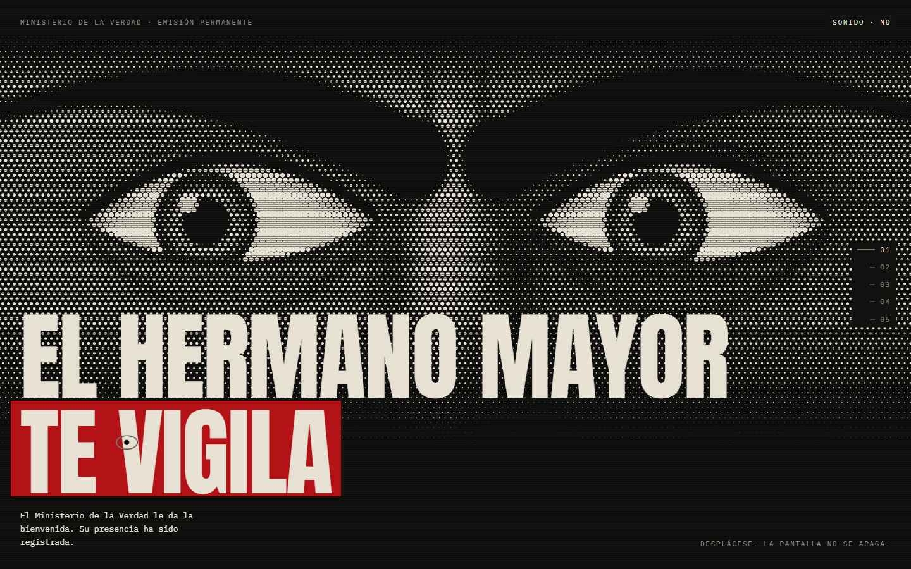

Una pieza narrativa interactiva de unos cinco minutos basada en *1984*, de George Orwell. No es un resumen ilustrado ni una landing: el visitante ocupa el lugar de un ciudadano de Oceanía y, al final, descubre que la web ha sido el telescreen todo el tiempo.

Hay un recorrido grabado de 40 segundos, sin audio, en [presentation/telescreen-recorrido.webm](presentation/telescreen-recorrido.webm).

## Concepto

- **Idea madre: la web es el telescreen.** Todo es diegético: el loader es el aparato calentándose, el scroll redacta un expediente, el cursor es observado.
- **Una sola idea visual: el punto de trama.** Los mismos puntos forman el cartel del Hermano Mayor, caen hasta convertirse en las ventanas de la ciudad y, al final, dibujan el mapa de atención del visitante.
- **Momento firma.** El cartel te sigue con la mirada y, al avanzar, se deshace; los ojos son lo último en desaparecer. De toda la ciudad, una sola ventana queda encendida en verde: la tuya. *Ciudadanos observados: 1.*
- **Recorrido material.** Pantalla → papel → papel corrupto → apagón → pantalla.
- **El giro.** El Ministerio del Amor entrega el expediente y, justo debajo, la pieza se quita la máscara: no había servidor ni ojos. El cartel vuelve con los ojos cerrados. El Estado habla siempre de «usted»; la verdad, al principio y al final, habla de «tú».

## Escenas

| # | Escena | Qué hace el visitante |
|---|---|---|
| 00 | Calibración | Enciende el aparato. Ese clic es el único que activa el sonido. |
| 01 | El Hermano Mayor | Mueve el cursor (los ojos le siguen) y hace scroll (el cartel se convierte en ciudad). |
| 02 | El diario | Escribe una frase. A los tres segundos cae el sello «Pensamiento criminal». |
| 03 | Doblepiensa | Acciona el interruptor «Verdad / Verdad» y arrastra palabras al agujero de la memoria. |
| 04 | Habitación 101 | Contesta, calla o se va. Puede borrar lo que ha dicho. |
| 05 | El archivo | Lee su expediente, generado en local, y después la verdad. |

## Capturas

| | |
|---|---|
| 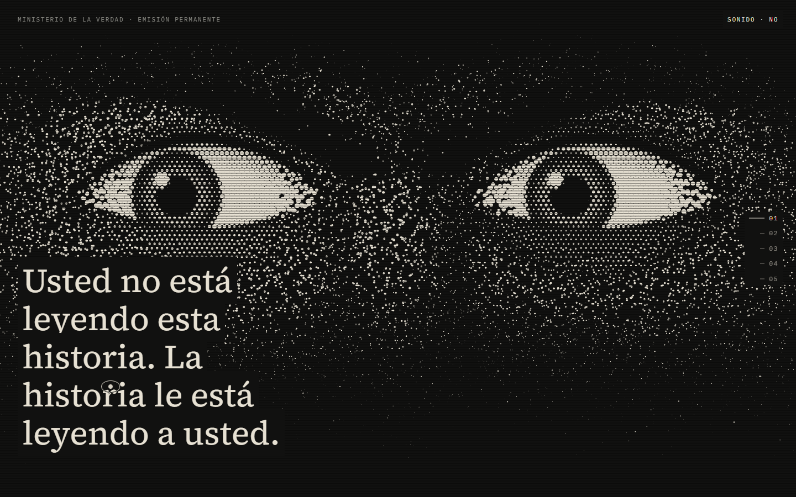 **01 ·** El cartel se deshace. Los ojos son lo último en irse. | 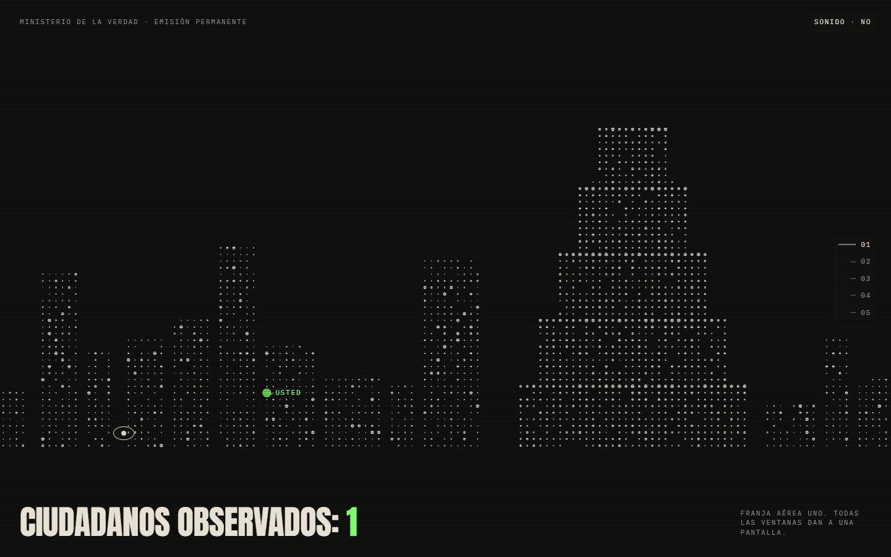 **01 ·** Cada punto es ahora una ventana. La verde es la tuya. |
| 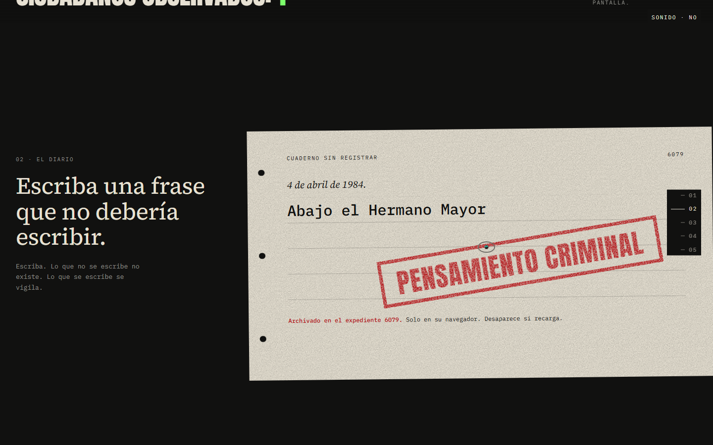 **02 ·** El diario, tres segundos después de la última tecla. | 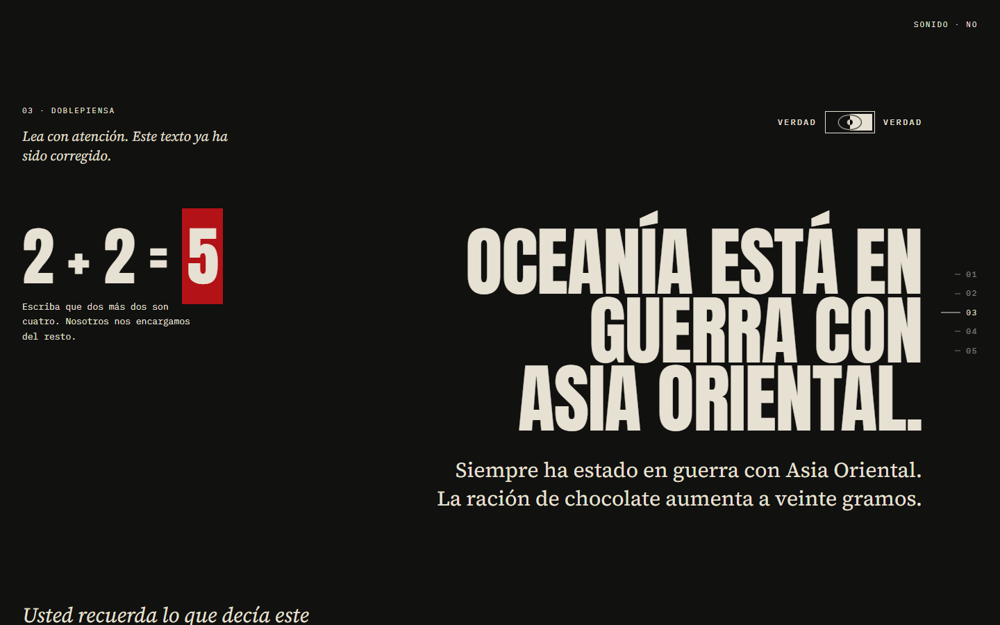 **03 ·** La otra verdad. |
| 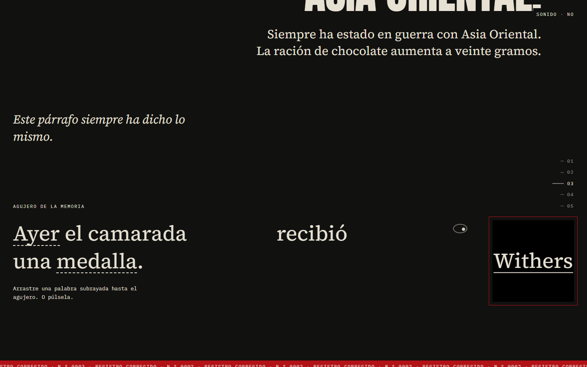 **03 ·** El agujero de la memoria. | 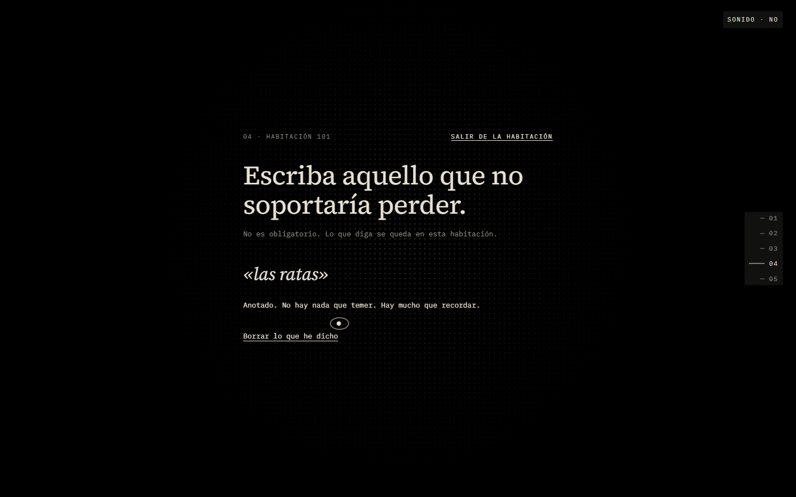 **04 ·** Habitación 101. |
| 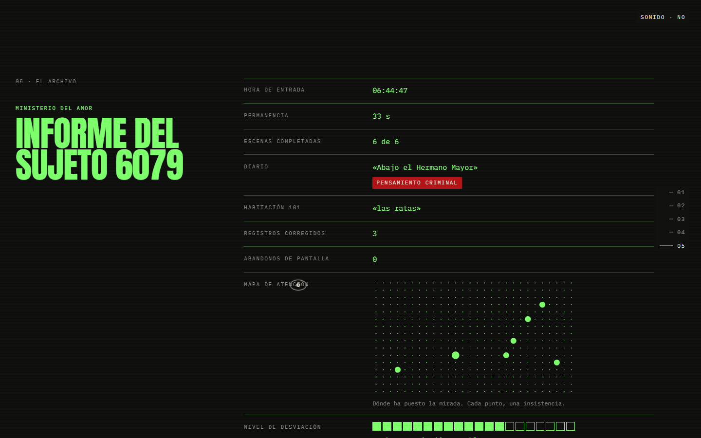 **05 ·** El expediente, compilado en el navegador. | 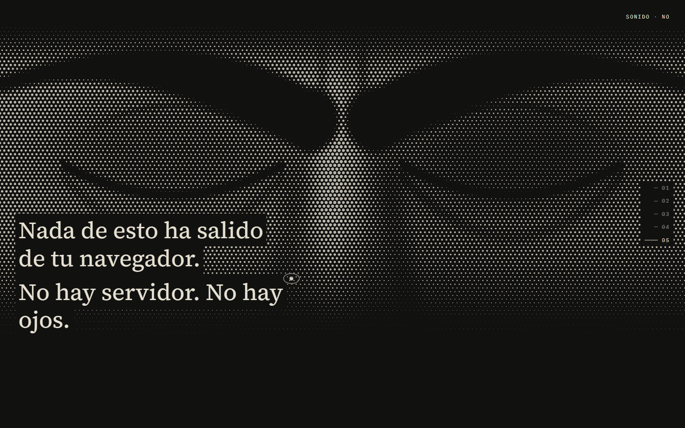 **05 ·** El giro. |

En móvil y en papel:

| Cartel | Ciudad | Expediente impreso |
|---|---|---|
| 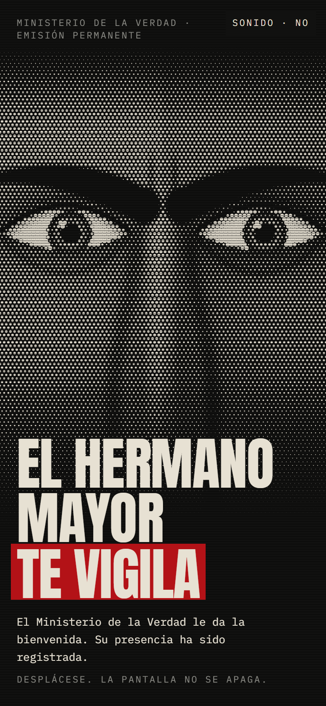 | 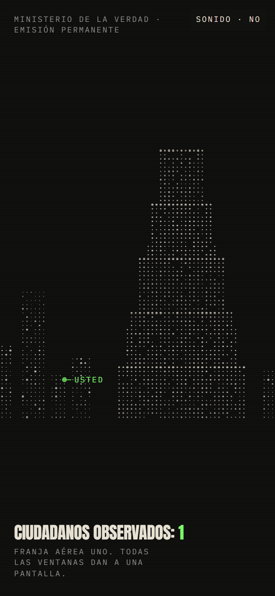 | 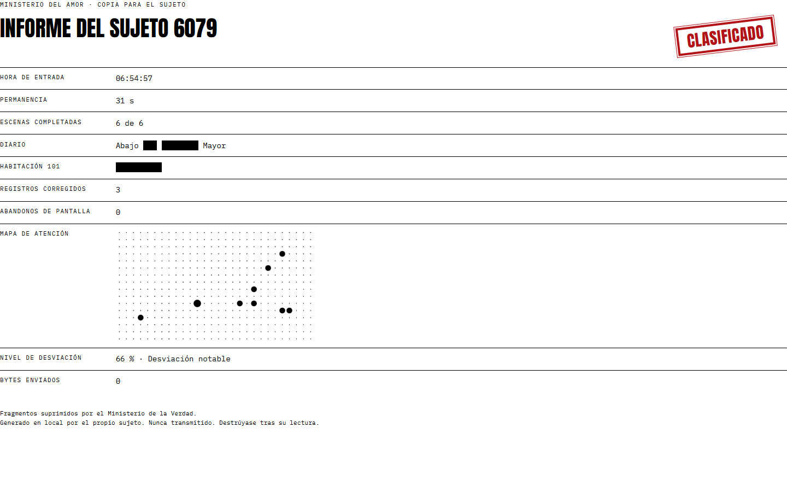 |

## Ponerlo en marcha

```bash
npm install
npm run dev        # desarrollo en http://localhost:3000
npm run build      # export estático en ./out
npm run preview    # sirve ./out con gzip en http://localhost:4173
npm run typecheck
```

Requiere Node 20 o superior. El resultado de `npm run build` es una carpeta `out/` estática que se puede subir a cualquier alojamiento (Vercel, Netlify, GitHub Pages, un bucket).

Antes de desplegar, define la URL pública para que canonical, Open Graph, `sitemap.xml` y `robots.txt` apunten al dominio real:

```bash
NEXT_PUBLIC_SITE_URL=https://tu-dominio.example npm run build
```

Parámetros de depuración: `?sin-webgl` fuerza el modo sin WebGL y `?calma` fuerza el modo de movimiento reducido.

## Stack y arquitectura

Next.js 16 (App Router, export estático) · React 19 · TypeScript estricto · Tailwind CSS 4 · GSAP + ScrollTrigger · Lenis · three + React Three Fiber · Zustand · Web Audio API.

```text
app/                  layout (metadatos, fuentes, JSON-LD), página, /lectura, sitemap, robots
components/
  experience/         Experience, SceneManager y las seis escenas
  canvas/             el único canvas WebGL: campo de puntos y shaders
  ui/                 cursor-ojo, sonido, índice, sello, agujero de la memoria, teletipo…
lib/                  estado narrativo, sesión en memoria, audio, scroll, expediente
content/              todo el copy (copy.es.ts) y los actos (acts.ts)
scripts/qa/           recorridos automatizados: teclado, capturas, fotogramas, vídeo
docs/capturas/        las imágenes de este README
presentation/         vídeo de 40 s para candidaturas
```

Por dónde empezar a leer el código:

| Si quieres cambiar… | Mira en… |
|---|---|
| Cualquier texto | `content/copy.es.ts` |
| El rostro del cartel (ojos, cejas, parpadeo) | `components/canvas/shaders.ts`, función `faceLum` |
| La ciudad y qué punto va a qué ventana | `components/canvas/field.ts` |
| El ritmo del morph o del giro final | las líneas de tiempo de `01-BigBrother.tsx` y `05-File.tsx` |
| El sonido de cada escena | la tabla `MIX` de `lib/audio.ts` |
| Cómo puntúa el «nivel de desviación» | `lib/deviation.ts` |
| Colores, tipografías y texturas | el bloque `@theme` y las superficies de `app/globals.css` |

Decisiones que conviene conocer:

- **El cartel es una función, no una imagen.** Cada punto calcula en el vertex shader la luminancia del rostro en su posición y la convierte en radio. Por eso los ojos pueden moverse y parpadear sin texturas, y por eso no hay fotografías ni fotogramas que licenciar.
- **Un solo canvas, fijo y detrás del DOM.** Todo el texto es DOM real. El canvas solo renderiza mientras la escena 01 o el cierre están en pantalla.
- **Sin `drei` ni `postprocessing`.** Trama, líneas de barrido y parpadeo van en el propio shader y en CSS.
- **three viaja en un chunk aparte** que se descarga durante la calibración. La calibración no depende de WebGL ni de JavaScript para pintarse.
- **`three` está fijado en 0.182.0**: R3F 9 usa `THREE.Clock`, que desde r183 emite un aviso de obsolescencia en consola.
- **Lenis solo en escritorio.** En táctil y con movimiento reducido el scroll es el nativo.
- **Sin persistencia.** No hay `localStorage`, `sessionStorage`, cookies ni llamadas de red. El estado vive en memoria y muere al recargar.

## Rendimiento medido

Medido en local sobre el export estático servido con gzip. No hay medición en un móvil físico: es lo que queda por comprobar antes de presentar la pieza.

| Métrica | Resultado | Presupuesto |
|---|---|---|
| JS inicial (gzip) | 238 KB | ≤ 250 KB |
| JS diferido: three + R3F (gzip) | 235 KB | — |
| CSS (gzip) | 9,6 KB | — |
| Audio | 0 KB (sintetizado) | < 3 MB |
| Lighthouse escritorio | 100 / 100 / 100 / 100 | ≥ 90 / 95 / 95 |
| Lighthouse móvil (3 pasadas) | 88–90 / 100 / 100 / 100 | ≥ 90 / 95 / 95 |
| LCP móvil (4G lenta, CPU ×4) | 0,8–0,9 s | < 2,5 s |
| TBT móvil | 400–470 ms | — |
| CLS | ≤ 0,022 | 0 |

El orden de Lighthouse es rendimiento / accesibilidad / buenas prácticas / SEO. El rendimiento móvil queda en el límite del objetivo: la pasada se hizo con Chrome sin GPU (WebGL por software), que penaliza el arranque del canvas.

Fotogramas durante el morph de la escena 01 (scroll continuo de ida y vuelta, 6 s), en una GeForce RTX 2060 Super con monitor de 180 Hz:

| Condición | Media | Peor fotograma | Fotogramas > 33 ms |
|---|---|---|---|
| 1440×900, sin freno | 180 fps | 5,9 ms | 0 |
| 390×844 @2x, CPU ×4 | 170 fps | 16,6 ms | 0 |
| 390×844 @2x, CPU ×6 | 105 fps | 22,3 ms | 0 |

El freno de CPU no frena la GPU, así que estas cifras no sustituyen a una prueba en un móvil de gama media.

## Verificación

Los recorridos automatizados están en `scripts/qa/`. Usan `playwright-core` con el Chrome instalado en la máquina (no descargan navegador) y esperan el export servido en el puerto 4173:

```bash
npm run build && npm run preview   # en una terminal
npm run qa:keys                    # en otra: recorrido solo con teclado y con sonido, 33 comprobaciones
npm run qa:shots                   # recorrido con capturas; admite `-- mobile` y `-- calm`
npm run qa:fps                     # regenera la imagen OG y mide fotogramas del morph
npm run qa:video                   # regraba presentation/telescreen-recorrido.webm
```

`qa:keys` termina con error si falla alguna comprobación o aparece algo en la consola. Además del teclado, comprueba que no se crea ningún `AudioContext` antes del primer gesto, que el audio se suspende al ocultar la pestaña y que no queda nada en `localStorage`, `sessionStorage` ni cookies. `qa:shots` lista las peticiones a otros orígenes, que deben ser cero. Para probar sin WebGL: `QS="?sin-webgl" npm run qa:shots` en bash, o `$env:QS='?sin-webgl'; npm run qa:shots` en PowerShell.

Las cifras de Lighthouse se obtuvieron con `npx lighthouse http://localhost:4173/` (móvil por defecto, y `--preset=desktop`).

## Accesibilidad

- Recorrido completo solo con teclado, comprobado con una prueba automatizada de 33 pasos (`npm run qa:keys`).
- Primer foco: «Saltar la introducción». El botón de sonido es el primer control tras encender.
- Foco visible en todas las superficies y `aria-live` para los cambios de escena, el sello, las correcciones y los avisos.
- El agujero de la memoria funciona arrastrando, tocando o con Intro; el interruptor es un `role="switch"`.
- Con `prefers-reduced-motion` no hay pins, scrub, partículas ni WebGL: solo fundidos, y el cartel es un SVG estático.
- Sin WebGL, la misma historia se cuenta en DOM. Sin JavaScript, queda el **modo lectura** en `/lectura/` (60 segundos de texto).
- Contraste AA en el texto de contenido. El rojo sobre negro y el gris sobre papel no llegan a AA y solo se usan en sellos y bandas con texto claro encima.
- Sin sustos, destellos ni picos de volumen; el sonido nunca empieza solo y se detiene al ocultar la pestaña.
- No hay líneas narradas, así que no hace falta transcripción.

## Privacidad

Nada de lo que el visitante escribe o hace sale de su navegador. No hay servidor, cámara, micrófono, cookies ni analítica, y la prueba automatizada verifica que no se emite ninguna petición a otro origen ni se escribe en el almacenamiento. La pieza lo dice al principio y al final. La hoja de impresión genera el expediente con lo escrito por el visitante censurado.

## Assets y licencias

| Asset | Origen | Licencia |
|---|---|---|
| Anton | Google Fonts, autoalojada con `next/font` | SIL OFL 1.1 |
| Source Serif 4 | Google Fonts, autoalojada con `next/font` | SIL OFL 1.1 |
| IBM Plex Mono | Google Fonts, autoalojada con `next/font` | SIL OFL 1.1 |
| Cartel, ciudad, sello, mapa de atención | Generados por código en este repositorio | Propios |
| Grano de papel y desgaste del sello | SVG `feTurbulence` en CSS | Propios |
| Sonido | Síntesis Web Audio en `lib/audio.ts` | Propio |
| Imagen OG (`public/og/telescreen.png`) | Captura de la propia pieza | Propia |
| Vídeo (`presentation/telescreen-recorrido.webm`) | Captura guionizada de 40 s, sin audio | Propio |
| Capturas (`docs/capturas/`) | Capturas de la propia pieza | Propias |

El repositorio no incluye todavía un archivo de licencia para el código.

## Derechos

*1984* no está en dominio público en todos los países (en España, hasta 2031; en EE. UU., hasta 2044). Por eso todo el copy es original, la única cita literal es una frase breve y atribuida, los nombres propios de la novela aparecen solo como alusión, y no se usa ninguna imagen de adaptaciones previas. TELESCREEN es una pieza independiente, sin ánimo de lucro y sin vinculación con los titulares de los derechos.

## Pendiente antes de presentarla

- Desplegar `out/` y fijar `NEXT_PUBLIC_SITE_URL`.
- Probar en un móvil físico de gama media (fotogramas, teclado virtual en el diario y la Habitación 101, barra de direcciones de iOS).
- Escuchar el diseño sonoro con auriculares y altavoces: está sintetizado y verificado técnicamente, pero no afinado de oído.
- Regrabar el vídeo con audio si la candidatura lo pide.
